<div align="center">


# BO1 Zombies Co-op

**Play Black Ops 1 Zombies in your browser with up to 4 friends, online.**<br>
A free Chrome extension for [vel.gg/bo1z](https://vel.gg/bo1z/): host a game, send a link, play Kino der Toten together.<br>
With controller support and a fun mode for the host (god mode, wonder weapons, infinite ammo, flying and more).

[](https://github.com/AllanLotta/bo1-zombies-coop/releases/latest)


### [⬇ Download the extension](https://github.com/AllanLotta/bo1-zombies-coop/releases/latest/download/bo1-zombies-coop.zip) · [Install guide with pictures](https://allanlotta.github.io/bo1-zombies-coop/)

**English** · [Português](#português)

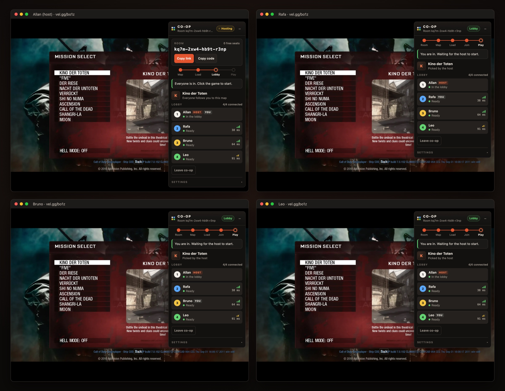

</div>

> [!IMPORTANT]
> **Playing with friends? [Create your own relay](#run-your-own-relay-recommended-for-your-group) first.** Co-op runs
> through a relay. The shared one is free but small: a few hours of play a day for **everyone** together, and when it
> runs out co-op stops until midnight UTC. Your own relay is free too, takes 5 minutes, and is only for your group.
> The Co-op card has a **Create my relay** button that takes you to the [step-by-step guide](https://allanlotta.github.io/bo1-zombies-coop/#relay).

## Features

- **Up to 4 players online**: one hosts, up to three join with an invite link. Works over the internet; nobody needs
  to be on the same Wi-Fi or open ports.
- **A lobby everyone sees**: each player's name, colour (white, blue, yellow, green, as on the BO1 scoreboard),
  status and ping, so you always know who is loading, joining or ready.
- **Everyone spawns together**: the host's start waits until the others are in (or starts now, if you prefer).
- **All 10 maps**, Hell mode included: Kino der Toten, Five, Der Riese, Nacht der Untoten, Verrückt, Shi No Numa,
  Ascension, Call of the Dead, Shangri-La and Moon.
- **Pause together**: any player opening the menu pauses everyone.
- **Fun mode** for the host: god mode, invisible, noclip, fly, speed and points per player; infinite ammo; one-hit or
  passive zombies; game speed, jump and gravity; wonder weapons. [More below](#fun-mode).
- **PlayStation and Xbox controllers** with adjustable aim speed.
- **English and Portuguese**, picked from your browser's language.
- **Stable**: fixes the crash where one player pressing Escape or T (chat) took down the other players' games.

<p align="center">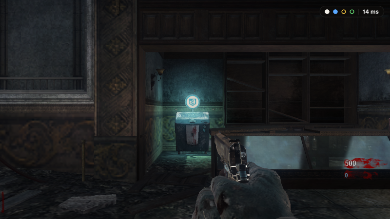<br><sub>In game, the card folds into a small indicator: one dot per player, and your ping</sub></p>

<table>
<tr>
<td align="center">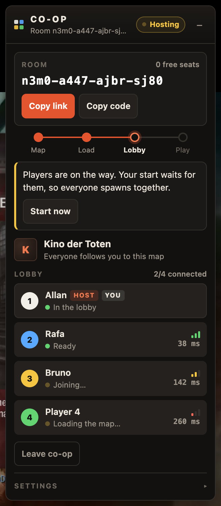<br><sub>Hosting: room code, steps, lobby</sub></td>
<td align="center">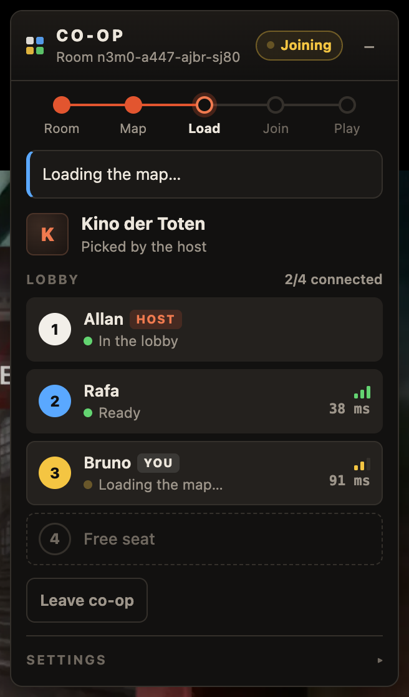<br><sub>Joining: progress and what to do next</sub></td>
<td align="center">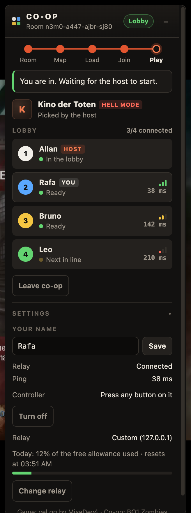<br><sub>In the lobby, with settings open</sub></td>
</tr>
</table>

## Install (2 minutes, every player)

Step-by-step page with pictures, in English and Portuguese: **[allanlotta.github.io/bo1-zombies-coop](https://allanlotta.github.io/bo1-zombies-coop/)**

1. **[Download the extension](https://github.com/AllanLotta/bo1-zombies-coop/releases/latest/download/bo1-zombies-coop.zip)** and unzip it.
   You get a folder called `bo1-zombies-coop`: move it somewhere it can stay (Chrome keeps using it).
2. Paste `chrome://extensions` into Chrome's address bar and switch on **Developer mode**, top right:

   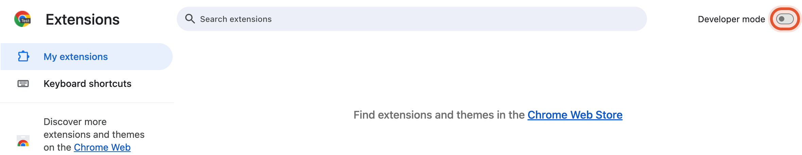
3. Click **Load unpacked** and pick the `bo1-zombies-coop` folder (the one with `manifest.json` inside):

   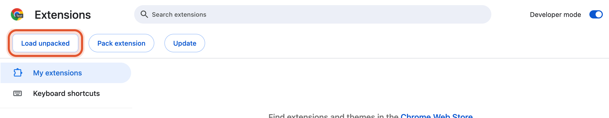
4. Done. Open [vel.gg/bo1z](https://vel.gg/bo1z/): the **Co-op** card appears in the top right corner.

   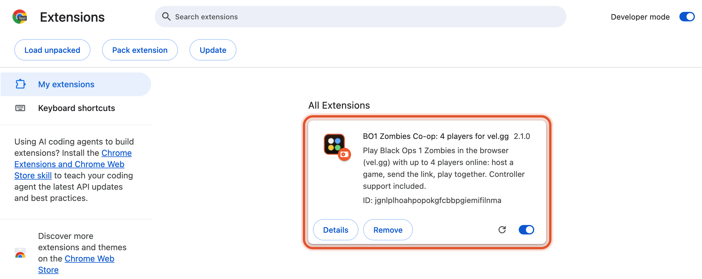

Chrome may show a popup about developer-mode extensions when it starts: that's normal, just close it.
When a new version is out, the Co-op card tells you and links to the [update steps](https://allanlotta.github.io/bo1-zombies-coop/#update).

## Play

**Host**

1. On the Co-op card, click **Host a game**, then **Copy link** and send it to your friends.
2. Pick a map. Everyone else follows you to it automatically.
3. Wait on the "click to start" screen until the lobby shows everyone as **Ready**, then click the game.

**Friends**

1. Open the invite link and press any key when the page asks, to load the map.
2. Wait until the card says **You are in**, then click the game.

Tips:

- Set your name under **Settings** so it shows in everyone's lobby.
- Somebody got disconnected? They click **Rejoin**. Joining after the start means watching until the next round,
  as in the original game.
- Spawned far away from the others? **Go to the host** on the card brings you next to them.

## Fun mode

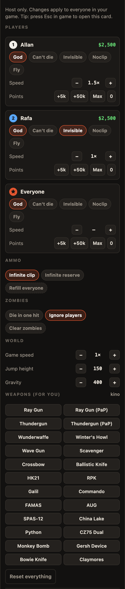

For the host, or when you play solo. It changes your own game server, so it applies to everyone in your game, and
your friends don't need anything extra. Press **Esc** in game to open the Co-op card, then **Fun mode**.

- **Per player, or everyone at once:** god mode, can't die, invisible to zombies, noclip, fly, speed from 0.5× to
  3×, points (+5k, +50k, max).
- **Ammo:** infinite clip, infinite reserve, refill everyone.
- **Zombies:** die in one hit, ignore players, clear the map.
- **World:** game speed, jump height, gravity.
- **Weapons for the host:** Ray Gun, Thundergun, Wunderwaffe, Winter's Howl, Wave Gun, Scavenger, Crossbow,
  Ballistic Knife, Monkey Bomb, Gersh Device and more, upgraded versions included. Only the ones that exist on the
  current map work; the card tells you when one doesn't.
- **Reset everything** puts the game back to normal.

Switch off Fly and Noclip while standing on the floor, or you fall out of the map.

Everything goes through the engine's own cheat mechanisms (the flags behind its `god`, `notarget`, `noclip` and
`ufo` console commands, its ammo and score fields, and commands such as `give`, `timescale` and `ai`).

<br clear="right">

## Troubleshooting

| Problem | What to do |
| --- | --- |
| "vel.gg updated its game engine…" | vel.gg shipped a new engine. Co-op switches itself off until this extension is updated; check for a new release. |
| "You and the host have different versions" | Both reload the page (the engine is cached per browser). |
| "This game is full" | A room holds 4 players. Wait for a free seat or host another room. |
| Stuck on "Next in line" | Players connect one at a time; it moves on within a minute. If it does not, reload. |
| vel.gg has its own multiplayer now | While you host or join from the Co-op card, the extension keeps vel.gg in single-player mode and runs co-op itself (lobby, controllers, synchronized pause, fun mode). To use vel.gg's own multiplayer, don't host or join from the card. |
| "This relay used up today's free allowance" | The shared relay is out for today (it comes back at midnight UTC). [Create your own relay](#run-your-own-relay-recommended-for-your-group): 5 minutes, free. |

Works in Chrome. Other Chromium browsers (Edge, Brave, Opera) load the same extension but are not tested.

## Run your own relay (recommended for your group)

Players connect through a small relay on Cloudflare that only forwards game packets. The default relay is shared by
**everyone** who uses the extension, on Cloudflare's free plan: about **4 hours of 2-player games, or 1½ hours of
4-player games, per day for all of them together**. When that runs out, co-op stops for everybody until midnight UTC,
and the card says so.

Your own relay is free too, takes about 5 minutes, and its allowance is only for the people you invite.

**With the button (no terminal):**

1. Create a free account at [dash.cloudflare.com/sign-up](https://dash.cloudflare.com/sign-up) and confirm your email.
2. Click [](https://deploy.workers.cloudflare.com/?url=https://github.com/AllanLotta/bo1-zombies-coop/tree/main/relay), sign in, allow it to
   create a copy of the relay in your GitHub account, and click **Deploy**. If Cloudflare asks you to pick a
   `workers.dev` subdomain, any name works.
3. Copy your relay's address when it is ready: `https://bo1-zombies-coop-relay.<your-name>.workers.dev`.
4. On the Co-op card: **Settings → Change relay**, paste it, **Save**.

Your invite links carry your relay, so friends switch to it with one click (**Use this relay** on their card).

**With the terminal** (needs [Node.js](https://nodejs.org) 22+):

```sh
git clone https://github.com/AllanLotta/bo1-zombies-coop
cd bo1-zombies-coop/relay
npm install
npx wrangler login     # opens the browser: click Allow
npx wrangler deploy    # prints your relay's address
```

Then step 4 above.

## How it works

vel.gg runs the decompiled Black Ops 1 engine as WebAssembly. The engine's own client and server still talk through
in-memory "loopback" queues, as a listen server does for its local player. The extension builds on that, separately
from vel.gg's own multiplayer (which it keeps switched off during a session):

1. **Patches the engine as it loads** (after checking its exact SHA-256 and every function by name): a mailbox for
   console commands, a switch to park the local server, an extra inbound queue for the host's server, and two
   crash fixes (players in a menu, and a command flood from guests waiting in the lobby).
2. **Gives each guest its own loopback queue on the host**, so the host's real game server sees up to three remote
   players as ordinary local clients, each with a distinct port and qport.
3. **Starts the host with vel.gg's own co-op rules** (`kisak_web_coop`): the level script treats the game as co-op
   rather than solo, and the round starts when the host clicks in, with everyone already connected. Game over slows
   every client down; after the restart the extension puts guests back to normal speed, which the engine only does
   where the server runs.
4. **Pumps packets** between those queues and a WebSocket in a Worker, through a Cloudflare Durable Object per room
   that routes them by seat without looking inside.

## Development

```
extension/        what players load: manifest, icons and the built coop.js
src/
  engine/         known engine builds, wasm patching, shared-memory access
  net/            packet pump worker and loopback queues
  session/        host, guest, lobby, control messages, engine hooks
  ui/             the card, its view model, styles and texts (EN/PT)
  input/          controller support
  fun/            fun mode (host cheats panel)
  game/ util/     vel.gg page helpers, settings, relay selection
relay/            Cloudflare Worker + Durable Objects, and the wire protocol (deploys on its own)
test/             relay, engine patch, end-to-end and UI preview tests
scripts/          build, packaging, icons and screenshots (README, install guide)
docs/             the install page (GitHub Pages) and its images
```

```sh
npm install
npm run build              # src/ -> extension/coop.js
npm run check              # lint + build + engine patch test
npm run relay:dev          # relay on http://127.0.0.1:8787
npm run test:relay         # routing test against it
node test/e2e.mjs 2 kino   # two real browsers playing through the local relay
npm run preview            # screenshots of every card state (no game loaded)
npm run package            # dist/bo1-zombies-coop.zip (same name every release, for the download link)
```

Each end-to-end player is a full game engine using several GB of memory: on a 16 GB machine, test with 3 at most.

## Credits

The game in the browser is [vel.gg](https://vel.gg/bo1z/) by MisaDev4, built on the decompiled engine. This project
started from invictus841's two-player co-op extension.

Not affiliated with Activision or Treyarch. Call of Duty and Black Ops are trademarks of Activision Publishing.

---

## Português

**Jogue Black Ops 1 Zombies no navegador com até 4 amigos, online.** Extensão gratuita do Chrome para o
[vel.gg/bo1z](https://vel.gg/bo1z/): um hospeda, manda o link, e todo mundo joga junto, inclusive no Kino der Toten.
Com controle e um modo diversão para o host (imortal, armas especiais, munição infinita, voar e mais).

> [!IMPORTANT]
> **Vai jogar com os amigos? [Crie o seu relay](#relay-próprio-recomendado-para-o-seu-grupo) antes.** O co-op passa
> por um relay. O compartilhado é grátis, mas pequeno: algumas horas de jogo por dia para **todo mundo** junto, e quando
> acaba o co-op para até as 21h (horário de Brasília). O seu próprio relay também é grátis, leva 5 minutos e é só do
> seu grupo. O cartão Co-op tem um botão **Criar meu relay** que leva ao [passo a passo](https://allanlotta.github.io/bo1-zombies-coop/?lang=pt#relay).

<table>
<tr>
<td align="center">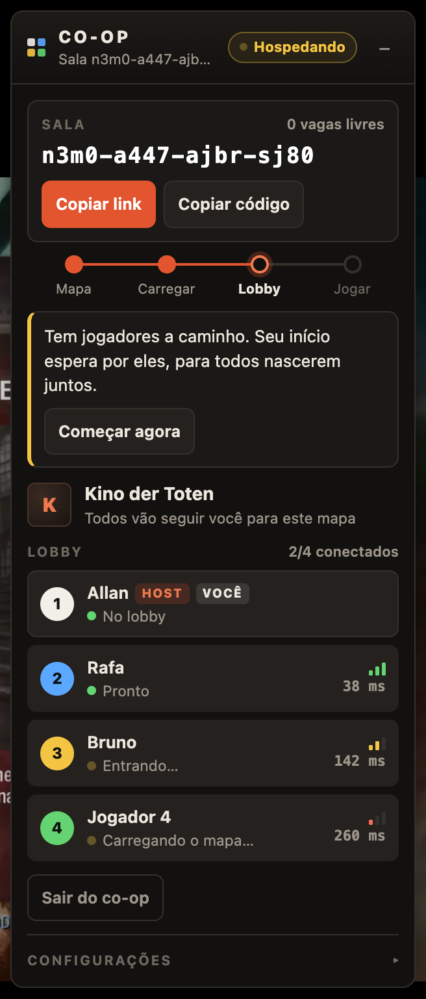<br><sub>Hospedando: código da sala e lobby</sub></td>
<td align="center">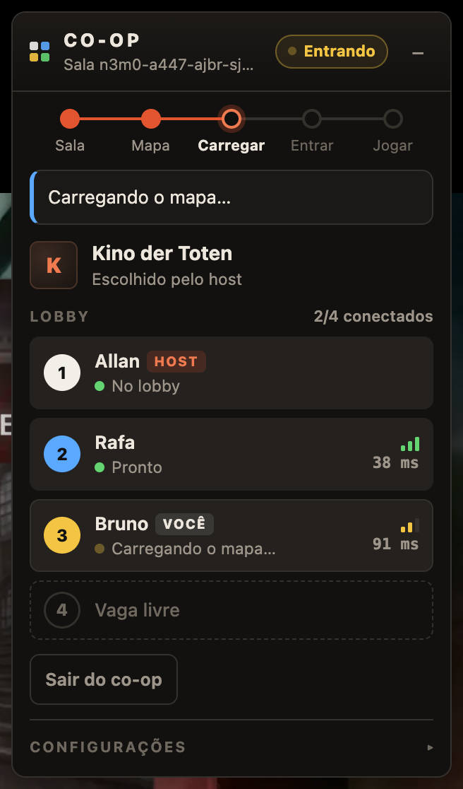<br><sub>Entrando: progresso e próximo passo</sub></td>
</tr>
</table>

### O que tem

- **Até 4 jogadores online**, pela internet, sem precisar estar na mesma rede nem abrir portas.
- **Lobby para todos**: nome, cor (branco, azul, amarelo, verde, como no placar do BO1), status e ping de cada um.
- **Todos nascem juntos**: o início do host espera os outros entrarem (ou começa na hora, se preferir).
- **Os 10 mapas**, com Hell mode.
- **Pausa sincronizada**: quem abre o menu pausa para todos.
- **Modo diversão** para o host: imortal, invisível, atravessar paredes, voar, velocidade e pontos por jogador;
  munição infinita; zumbis de 1 tiro ou que ignoram vocês; velocidade do jogo, pulo e gravidade; armas especiais.
  [Detalhes abaixo](#modo-diversão).
- **Controle de PlayStation e Xbox**, com ajuste de velocidade da mira.
- **Em português** quando o navegador está em português.
- **Corrige o crash** em que um jogador apertando ESC ou T (chat) derrubava o jogo dos outros.

### Instalar (2 minutos, cada jogador)

Passo a passo com imagens: **[allanlotta.github.io/bo1-zombies-coop](https://allanlotta.github.io/bo1-zombies-coop/?lang=pt)**

1. **[Baixe a extensão](https://github.com/AllanLotta/bo1-zombies-coop/releases/latest/download/bo1-zombies-coop.zip)** e descompacte.
   Aparece uma pasta `bo1-zombies-coop`: deixe ela num lugar fixo, como Documentos (o Chrome continua usando a pasta).
2. Cole `chrome://extensions` na barra de endereços do Chrome e ligue o **Modo do desenvolvedor**, no canto superior direito:

   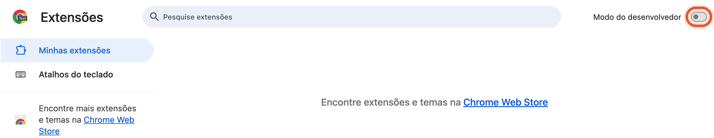
3. Clique em **Carregar sem compactação** e escolha a pasta `bo1-zombies-coop` (a que tem o `manifest.json` dentro):

   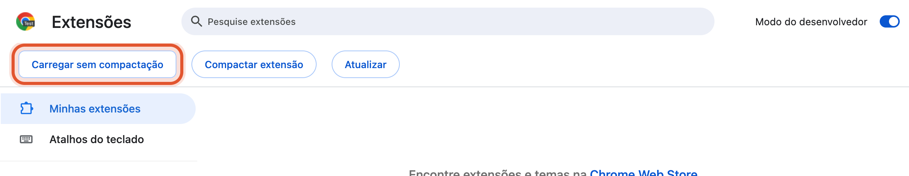
4. Pronto. Abra o [vel.gg/bo1z](https://vel.gg/bo1z/): o cartão **Co-op** aparece no canto superior direito.

   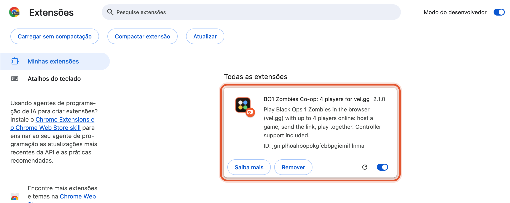

Ao abrir, o Chrome pode mostrar um aviso sobre extensões em modo de desenvolvedor: é normal, só feche.
Quando sair versão nova, o cartão avisa e mostra [como atualizar](https://allanlotta.github.io/bo1-zombies-coop/?lang=pt#update).

### Jogar

**Host:** clique em **Hospedar partida**, depois em **Copiar link**, e mande para os amigos. Escolha o mapa (todos vão
junto). Espere na tela "click to start" até todos aparecerem como **Pronto** no lobby e clique no jogo.

**Amigos:** abram o link e apertem qualquer tecla quando a página pedir, para carregar o mapa. Quando o cartão disser
**Você entrou**, cliquem no jogo.

Dicas: coloque seu nome em **Configurações**. Se alguém cair, é só clicar em **Voltar para a partida** (quem entra
depois do início assiste até a próxima rodada, como no jogo original). Nasceu longe? **Ir até o host**.

### Modo diversão

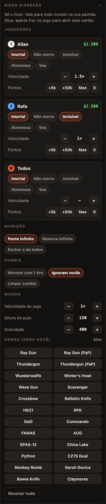

Para quem hospeda, ou quando você joga sozinho. Ele mexe no seu próprio servidor do jogo, então vale para todo mundo
na sua partida, e os amigos não precisam de nada a mais. Aperte **Esc** no jogo para abrir o cartão Co-op e depois
**Modo diversão**.

- **Por jogador, ou todos de uma vez:** imortal, não morre, invisível para os zumbis, atravessa paredes, voa,
  velocidade de 0,5× a 3×, pontos (+5k, +50k, máximo).
- **Munição:** pente infinito, reserva infinita, encher a de todos.
- **Zumbis:** morrem com 1 tiro, ignoram vocês, limpar o mapa.
- **Mundo:** velocidade do jogo, altura do pulo, gravidade.
- **Armas para o host:** Ray Gun, Thundergun, Wunderwaffe, Winter's Howl, Wave Gun, Scavenger, Crossbow, Ballistic
  Knife, Monkey Bomb, Gersh Device e outras, inclusive as versões turbinadas. Só funcionam as que existem no mapa
  atual; o cartão avisa quando uma não existe.
- **Resetar tudo** volta o jogo ao normal.

Desligue Voa e Atravessa com os pés no chão, senão você cai para fora do mapa.

<br clear="right">

### Problemas comuns

| Problema | O que fazer |
| --- | --- |
| "O vel.gg atualizou o motor do jogo…" | Saiu um motor novo; o co-op se desliga até a extensão ser atualizada. Veja se há versão nova. |
| "Versões diferentes do jogo" | Os dois recarregam a página. |
| "Esta partida está cheia" | A sala comporta 4 jogadores. |
| Parado em "Na fila para entrar" | Os jogadores entram um de cada vez; em até um minuto anda. Se não, recarregue. |
| O vel.gg agora tem multiplayer próprio | Quando você hospeda ou entra pelo cartão Co-op, a extensão deixa o vel.gg no modo single player e faz o co-op ela mesma (lobby, controle, pausa sincronizada, modo diversão). Para usar o multiplayer do vel.gg, é só não hospedar nem entrar pelo cartão. |
| "Este relay usou toda a cota grátis de hoje" | O relay compartilhado acabou por hoje (volta às 21h de Brasília). [Crie o seu relay](#relay-próprio-recomendado-para-o-seu-grupo): 5 minutos, grátis. |

### Relay próprio (recomendado para o seu grupo)

O relay padrão é dividido por **todo mundo** que usa a extensão, no plano grátis da Cloudflare: umas **4 horas de jogo
a 2, ou 1 hora e meia a 4, por dia, para todos juntos**. Quando acaba, o co-op para até as 21h (meia-noite UTC) e o
cartão avisa. O seu próprio relay também é grátis, leva uns 5 minutos e a cota dele é só do seu grupo.

**Pelo botão (sem terminal):**

1. Crie uma conta grátis em [dash.cloudflare.com/sign-up](https://dash.cloudflare.com/sign-up) e confirme o e-mail.
2. Clique em [](https://deploy.workers.cloudflare.com/?url=https://github.com/AllanLotta/bo1-zombies-coop/tree/main/relay), entre na conta,
   autorize a criação de uma cópia do relay no seu GitHub e clique em **Deploy**. Se a Cloudflare pedir um subdomínio
   `workers.dev`, qualquer nome serve.
3. Copie o endereço do seu relay quando ficar pronto: `https://bo1-zombies-coop-relay.<seu-nome>.workers.dev`.
4. No cartão Co-op: **Configurações → Trocar relay**, cole o endereço e clique em **Salvar**.

Os seus links de convite já levam o relay junto: os amigos só clicam em **Usar este relay** no cartão deles.
Pelo terminal: veja os comandos na seção em inglês, acima.
